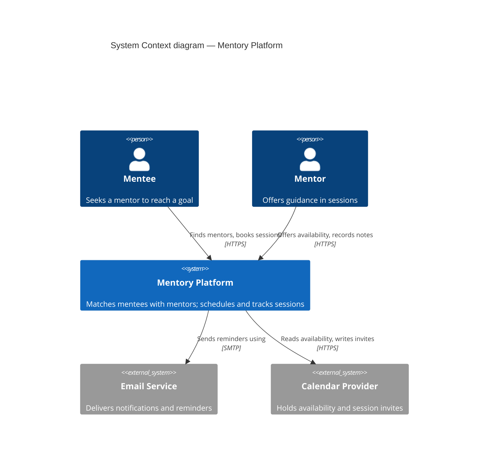
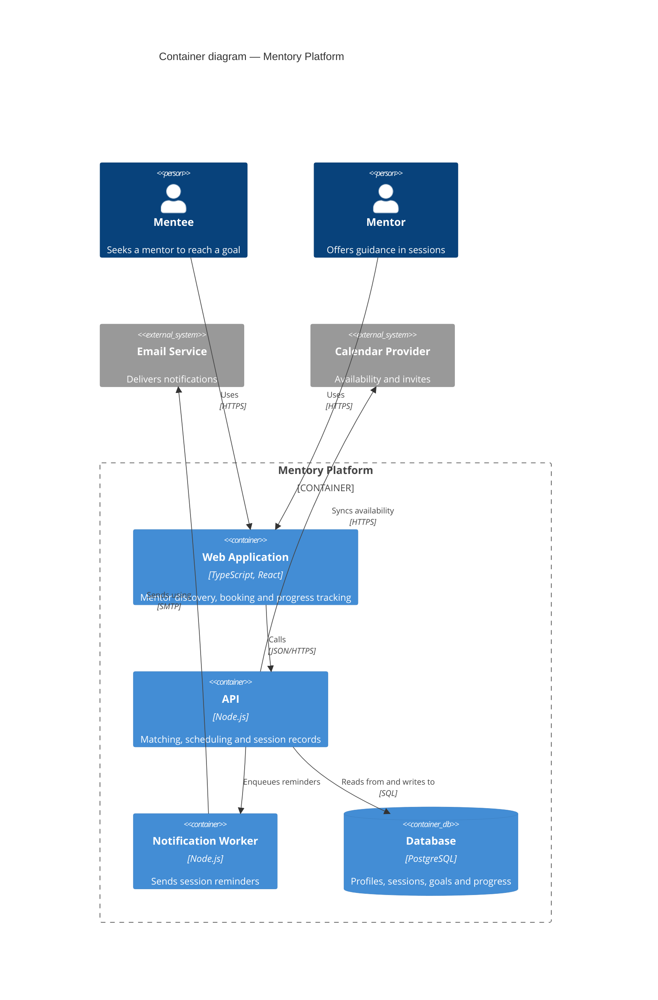
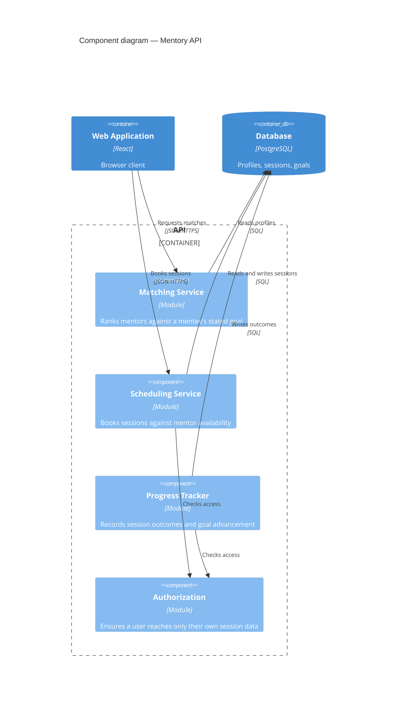

# Software architecture diagrams with C4

Produce architecture diagrams as Mermaid C4 blocks in fenced ` ```mermaid ` code blocks.
They render natively in the agent app, on GitHub, and in artifacts — no tooling, no build
step — and because they are text, they diff in pull requests like code.

A diagram earns its place by showing something prose cannot: how parts relate. If a
sentence would do the job, write the sentence.

## Pick the level before drawing

C4 is a zoom sequence. Each level answers one question for one audience. Drawing the wrong
level is the most common failure — usually by cramming implementation detail into a diagram
meant for a non-technical reader.

| Level | Question | Audience | Boxes are |
| --- | --- | --- | --- |
| 1. System Context | How does this system fit into its world? | Anyone, technical or not | People and whole systems |
| 2. Container | What are the deployable/runnable parts? | Developers, operators | Apps, services, databases, workers |
| 3. Component | What's inside one container? | Developers on that container | Modules, services, major classes |

Rules that keep the levels honest:

- **One level per diagram.** Never mix containers and components in the same picture.
- **Start at Context** unless the request is clearly narrower. It is the cheapest diagram to
  draw and most often the only one needed.
- **Draw Component sparingly.** It dates fastest and is the first to drift from the code.
  Only draw it for a container whose internals are genuinely hard to follow.
- A **container is not a Docker container.** It is a separately runnable or deployable
  thing: a web app, an API, a database, a worker. This confuses people constantly — say
  which you mean when it could be read either way.

## Syntax

Three diagram types, one per level: `C4Context`, `C4Container`, `C4Component`.

Element declarations take `(alias, "Label", "Technology or description", "Description")`.
The `_Ext` suffix marks anything outside your control — it renders grey, which is the
fastest way to read ownership off a diagram.

| Element | Use for |
| --- | --- |
| `Person(alias, "Name", "Description")` | A human user. `Person_Ext` for an external one |
| `System(alias, ...)` / `System_Ext` | A whole software system (Context level) |
| `SystemDb`, `SystemQueue` | A system that is principally a datastore or queue |
| `Container(alias, "Name", "Tech", "Description")` | A runnable part (Container level) |
| `ContainerDb`, `ContainerQueue` | A database or queue container |
| `Component(alias, "Name", "Tech", "Description")` | A module inside a container |
| `Container_Boundary(alias, "Name") { ... }` | Groups what is inside one system or container |
| `Enterprise_Boundary`, `System_Boundary` | Organisational or system grouping at Context level |

Relationships are directional and must say **what flows and how**:

```
Rel(from, to, "Does what", "Protocol or technology")
BiRel(a, b, "Exchanges", "HTTPS")
Rel_Back(db, api, "Returns results to")
```

A relationship labelled only "uses" or "calls" wastes the edge. `"Books sessions"` with
`"JSON/HTTPS"` tells a reader something; `"uses"` does not.

## Layout: declaration order is layout

Mermaid's C4 renderer has no real layout engine. It places shapes **in the order you declare
them**, filling rows left to right. Treat declaration order as a design decision, not
bookkeeping — this is the difference between a readable diagram and a tangle.

1. **Declare in reading order.** People first, then the system boundary and its insides,
   then external systems. Put elements that talk to each other near each other in the source.
2. **Set the row width** with `UpdateLayoutConfig` at the end of the block:
   `UpdateLayoutConfig($c4ShapeInRow="2", $c4BoundaryInRow="1")`. Default is 4 per row,
   which is too wide for most diagrams — 2 or 3 usually reads better.
3. **Nudge colliding labels** with `UpdateRelStyle(from, to, $offsetX="-70", $offsetY="-10")`.
   Long edges that cross the diagram drop their label in the middle, frequently on top of a
   box. Offsets are in pixels, positive X is right and positive Y is down.
4. **If it still looks wrong, remove something.** More than about 10 shapes will not lay out
   well no matter how many offsets you add. Split it into two diagrams at different levels,
   or narrow the scope.

Always state the title with `title <Level> diagram — <subject>` as the first line after the
diagram type.

## Verify before you ship

**You cannot tell whether a C4 diagram is readable by looking at its source.** Valid syntax
routinely renders with crossed edges and labels sitting on top of boxes. If a diagram is
going into a document someone will rely on, render it and look at it:

```bash
npx -y @mermaid-js/mermaid-cli@latest -i diagram.mmd -o diagram.png
```

Then read the PNG and check: do any labels overlap a shape? Do edges cross more than once or
twice? Is the boundary where you expect? Fix with declaration order first, offsets second,
and by deleting elements third.

For a quick sketch inside a chat reply, shipping the fenced block unrendered is fine.

## Worked examples

All three render correctly as written. Adapt rather than invent syntax.

### Level 1 — System Context



### Level 2 — Container

Note the order: people, then the boundary with its containers, then external systems. The
two `UpdateRelStyle` lines move labels off edges that would otherwise cross a box.



### Level 3 — Component

Scope to **one** container. Declare the containers it talks to outside the boundary.



## Diagram the system that exists

When diagramming a real codebase, read it first — entry points, deployment and CI config,
service definitions, database connections — and draw what is actually there. A diagram of
the intended architecture, presented as the current one, is worse than no diagram: it
misleads precisely the reader who most needs the truth.

If you are drawing a proposed design rather than the current system, label it as proposed in
the title. Where you are unsure whether something exists, say so alongside the diagram
rather than quietly drawing it as fact.

## Known limitations

- **Mermaid's C4 support is experimental** and its syntax may change between versions. If a
  diagram fails to render, check the Mermaid version before assuming the syntax is wrong.
- **There is no automatic layout.** Everything above about declaration order exists because
  the renderer will not rescue a badly ordered diagram.
- **`UpdateElementStyle` and sprites are unreliable** across renderers. Avoid styling beyond
  the `_Ext` convention, which is built in and works.
- For a large architecture maintained over time — one model, many generated views — C4 is
  better served by Structurizr DSL than by hand-written Mermaid. Mermaid is the right tool
  for diagrams that live beside the code and change with it.
