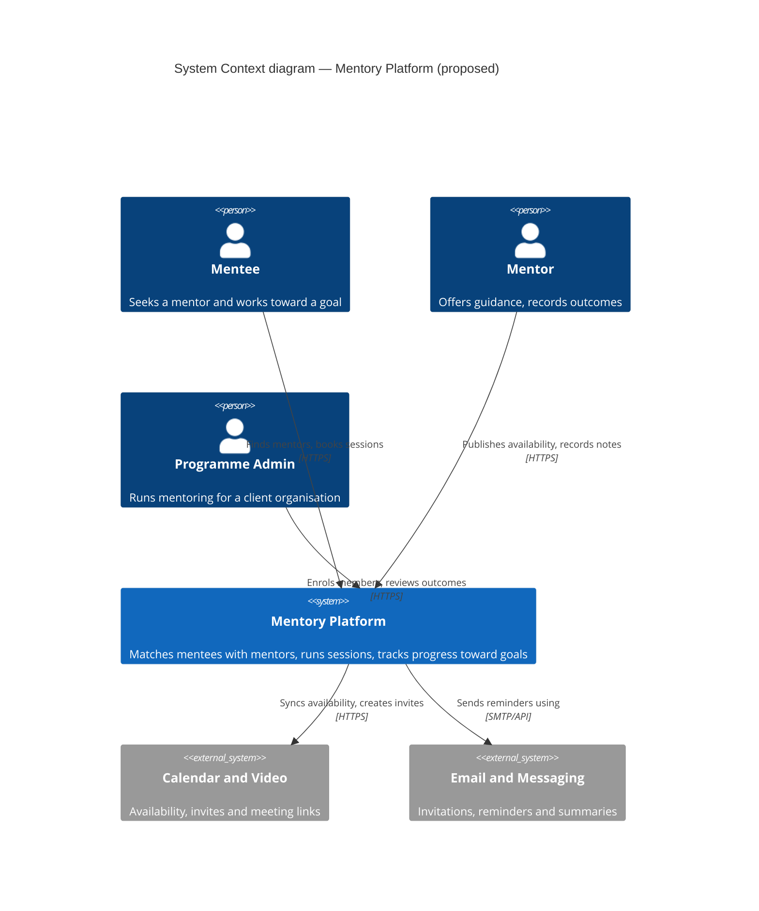
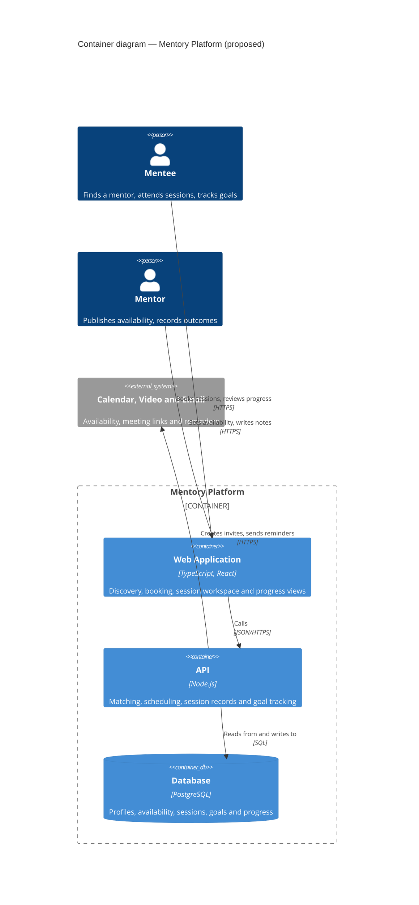

# Mentory Platform architecture (proposed)

> **Status: proposed, not built.** No application code exists in this repository yet — it
> currently holds only the business-context MCP server and the agent tooling. These diagrams
> describe a design derived from the company context, not a record of a running system.
> Revise them against the code once it exists, and drop this notice when they describe
> something real.

Mentory corp brings mentors and mentees together, providing the tools they need to handle
mentoring sessions, track progress, and reach their goals. The authoritative company
context, OKRs, and quality attributes live in [`context/`](../context/) and are served by
the `business-context` MCP server; this document covers structure only.

Diagrams follow the [C4 model](https://c4model.com/) and are written as Mermaid, per the
[`architecture-diagrams`](../.claude/skills/architecture-diagrams/SKILL.md) skill.

## Level 1 — System Context

Who uses Mentory and what it depends on.

A **Programme Admin** appears because the target audience includes SMBs and enterprise
clients: organisations buy mentoring programmes, and somebody enrols members and reviews
outcomes on their behalf. That role has different needs from an individual mentee and is
easy to forget when designing for individuals alone.



## Level 2 — Container

The separately runnable parts. "Container" here means a deployable unit — a web app, an
API, a database — not a Docker container.

The database description carries the three capabilities the company describes: sessions,
goals, and progress are all persisted state, and losing any of them loses the product.



The technology choices (React, Node.js, PostgreSQL) are placeholders chosen to make the
diagram concrete. Nothing has been decided; replace them when it is.

## Level 3 — Component (API)

Inside the API, where "track progress and reach their goals" becomes structure.

The load-bearing relationship is **Sessions → Goals and Progress**. Without it, sessions
happen and goals sit inert beside them, and the platform records mentoring without ever
showing whether it worked. Everything else here is ordinary; that edge is the one worth
arguing about.

```mermaid
C4Component
    title Component diagram — Mentory API (proposed)

    Container(web, "Web Application", "React", "Browser client")

    Container_Boundary(api, "API") {
        Component(match, "Matching", "Module", "Ranks mentors against a mentee's stated goal")
        Component(sessions, "Sessions", "Module", "Books, reschedules and records mentoring sessions")
        Component(goals, "Goals and Progress", "Module", "Holds goals and advances them from session outcomes")
    }

    ContainerDb(db, "Database", "PostgreSQL", "Profiles, availability, sessions, goals")

    Rel(web, match, "Requests mentor matches", "JSON/HTTPS")
    Rel(web, sessions, "Books and records sessions", "JSON/HTTPS")
    Rel(web, goals, "Reads goal progress", "JSON/HTTPS")
    Rel(sessions, goals, "Reports session outcomes to")
    Rel(api, db, "All modules read from and write to", "SQL")

    UpdateRelStyle(web, match, $offsetX="-80", $offsetY="-20")
    UpdateRelStyle(web, sessions, $offsetX="20", $offsetY="-40")
    UpdateRelStyle(web, goals, $offsetX="-60", $offsetY="150")
    UpdateRelStyle(sessions, goals, $offsetX="0", $offsetY="-10")
    UpdateLayoutConfig($c4ShapeInRow="2", $c4BoundaryInRow="1")
```

## What these diagrams leave out

Each was rendered and visually inspected, then simplified until it read clearly. Mermaid's
C4 renderer has no layout engine, and past roughly eight shapes it produces crossed edges
and labels sitting on top of boxes. In every case the fix was removing elements rather than
adding offsets.

Omitted for legibility, not because they do not matter:

| Omitted | From | Why it still matters |
| --- | --- | --- |
| Identity Provider (workplace SSO) | Level 1 | Enterprise and institutional clients will expect SSO; it affects onboarding and access control |
| Reminder Worker | Level 2 | Reminders drive attendance, which drives the completed-sessions key result |
| Access Control module | Level 3 | Load-bearing for the Security quality attribute — see below |
| Per-module database edges | Level 3 | Collapsed into one boundary-level relationship; each module does read and write |

**Access control deserves its own treatment.** It is cross-cutting — every module needs it —
so a single arrow from one component misrepresents how it works. The Security quality
attribute requires that "a mentor can reach only their own mentees' data, and a mentee only
their own"; that constraint should be documented explicitly rather than implied by a box in
a component diagram.

## Keeping these current

A diagram presented as current while describing something else misleads precisely the reader
who most needs the truth. When the code exists:

1. Read what is actually there — entry points, deployment config, service definitions,
   database connections — and redraw from that, not from this document.
2. Remove the "proposed" notice and the titles' "(proposed)" suffix only once each diagram
   matches reality.
3. Re-render and look at the output before committing. Valid syntax routinely renders
   illegibly, and that is not visible in the source:
   ```bash
   npx -y @mermaid-js/mermaid-cli@latest -i diagram.mmd -o diagram.png
   ```
